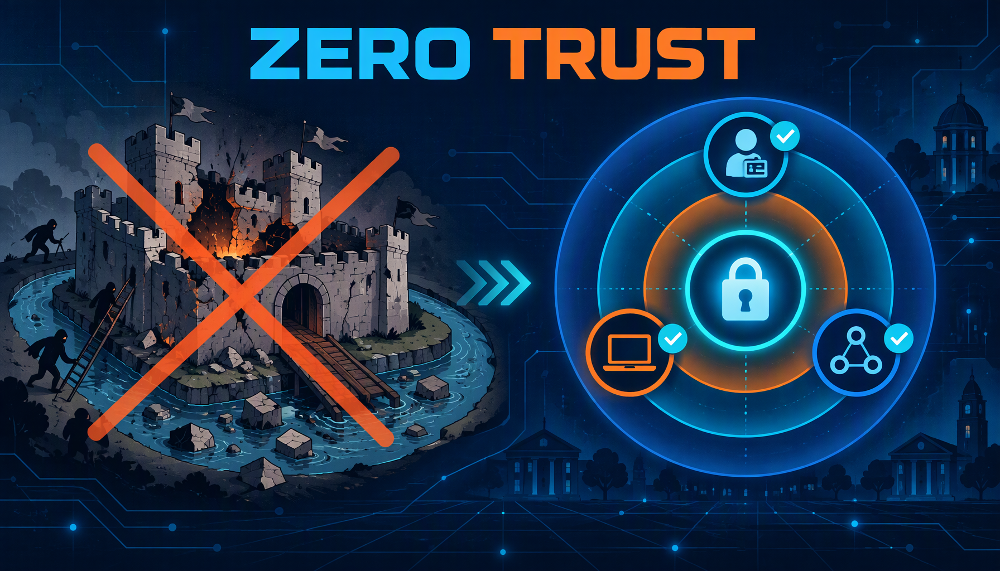
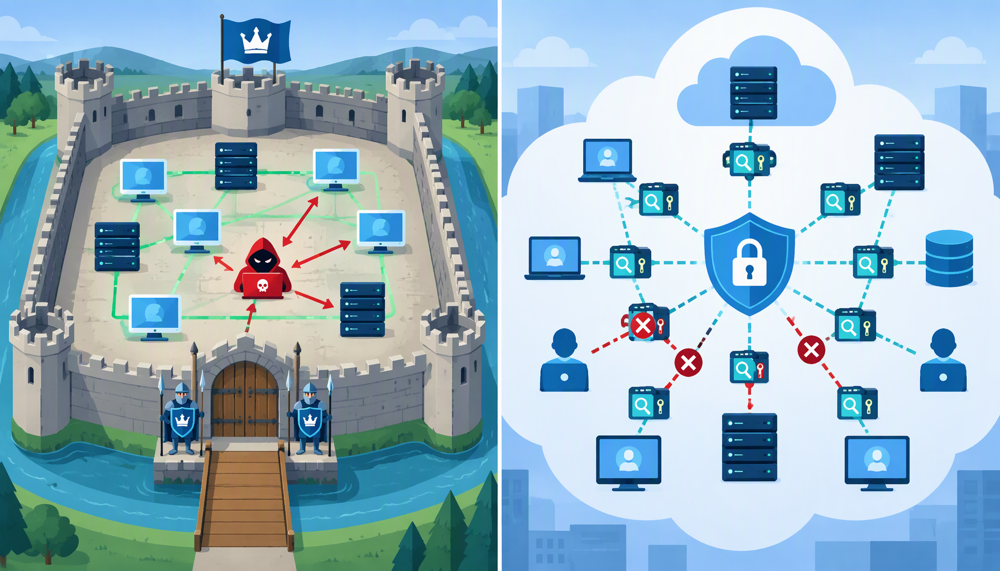
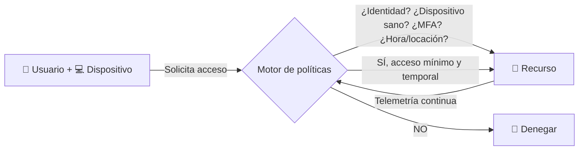
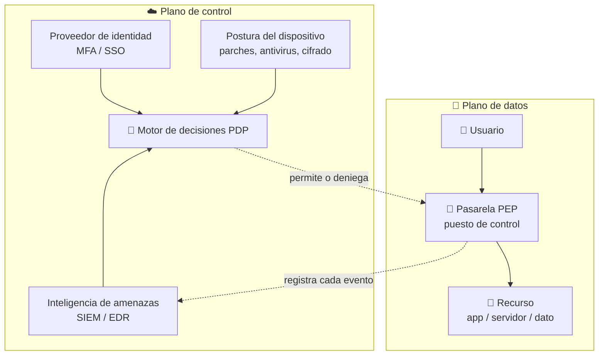
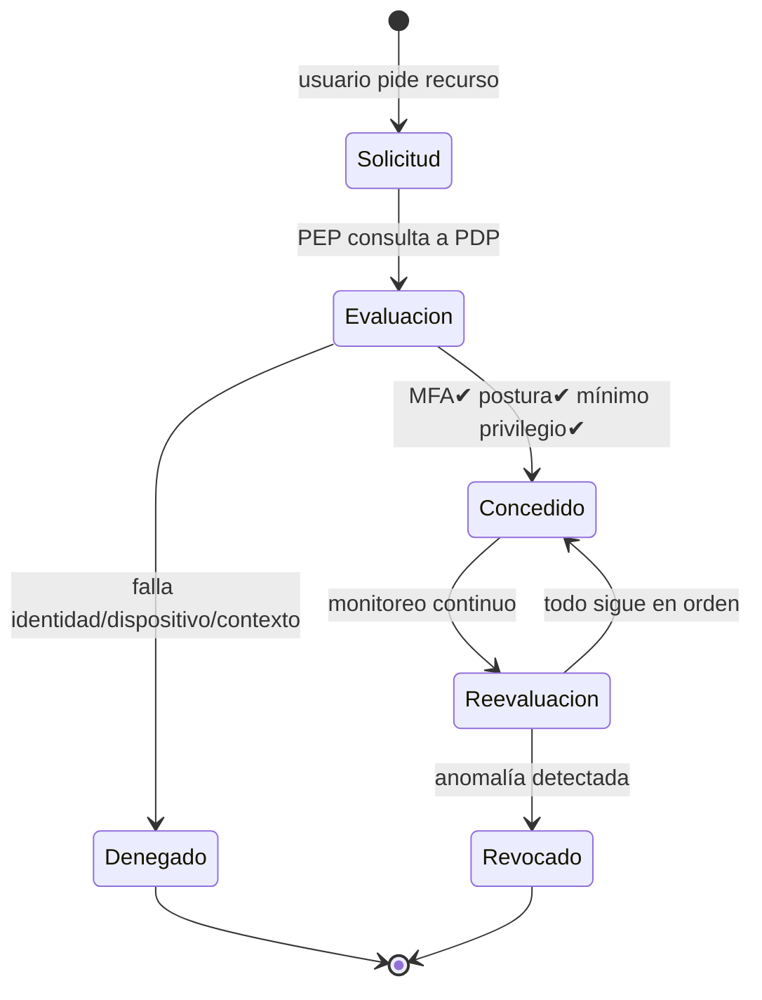
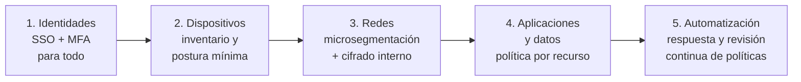

# 🛡️ Zero Trust: La ciberseguridad sin confianza ciega

**Exposición de Ingeniería de Sistemas**
*Basado en laboratorios y notas propias de hacking ético y hardening.*

---

## 📑 Tabla de contenido

1. [¿Qué es Zero Trust?](#1-qué-es-zero-trust)
2. [Por qué falla el modelo tradicional](#2-por-qué-falla-el-modelo-tradicional-el-castillo-con-foso)
3. [Los 3 principios fundamentales](#3-los-3-principios-fundamentales)
4. [Arquitectura: cómo funciona por dentro](#4-arquitectura-cómo-funciona-por-dentro)
5. [Los pilares del Zero Trust](#5-los-pilares-del-zero-trust)
6. [Caso práctico real: laboratorio de evasión de antivirus](#6-caso-práctico-real-laboratorio-de-evasión-de-antivirus)
7. [Ataques del mundo real que Zero Trust mitiga](#7-ataques-del-mundo-real-que-zero-trust-mitiga)
8. [Modelo perimetral vs Zero Trust](#8-modelo-perimetral-vs-zero-trust)
9. [Cómo adoptar Zero Trust (hoja de ruta)](#9-cómo-adoptar-zero-trust-hoja-de-ruta)
10. [Conclusiones](#10-conclusiones)
11. [Referencias](#11-referencias)

---

## 1. ¿Qué es Zero Trust?

**Zero Trust (Confianza Cero)** es un modelo de seguridad que asume que **ninguna persona, dispositivo o conexión es confiable por defecto**, sin importar si está dentro o fuera de la red de la organización. Cada intento de acceso debe ser **verificado explícitamente** cada vez.

Su lema se resume en tres palabras: **"Nunca confíes, siempre verifica"** (*Never trust, always verify*).

### Origen

| Año | Hito |
|-----|------|
| 2010 | **John Kindervag** (analista de Forrester) acuña el término Zero Trust. |
| 2014 | **Google** publica su implementación interna: **BeyondCorp** — sus empleados acceden a los recursos por internet sin VPN, con verificación continua. |
| 2020 | El **NIST** lo formaliza como estándar: **SP 800-207** (*Zero Trust Architecture*). |
| 2022 | La **Casa Blanca** (EO 14028) obliga a las agencias de EE. UU. a adoptar arquitecturas Zero Trust. |

> 💡 **Idea clave:** Zero Trust no es un producto que se compra en una caja. Es una **filosofía de diseño** que se implementa con varias herramientas trabajando juntas (identidad, red, dispositivos, monitoreo).

---

## 2. Por qué falla el modelo tradicional: "el castillo con foso"

La seguridad clásica funciona como un castillo medieval:

- 🏰 Un **foso y un muro** (firewall perimetral) separan lo "confiable" (adentro) de lo "peligroso" (afuera).
- 🚪 Un **único portón** (VPN) para entrar.
- ⚔️ Una vez adentro, **todo lo demás es confianza ciega**: cualquier empleado puede hablar con cualquier servidor.

El problema: **el atacante solo necesita pasar el portón una vez** (con un phishing, una credencial filtrada o un punto de acceso Wi-Fi comprometido), y desde ahí tiene las puertas interiores abiertas de par en par. Esto se conoce como **ataque de movimiento lateral** (*lateral movement*): entrar por un punto débil y saltar de máquina en máquina hasta el objetivo.

> 📌 La mayoría de las brechas grandes (Target, SolarWinds, Colonial Pipeline) siguieron exactamente este guion: **romper el perímetro → moverse libremente por adentro**. Zero Trust ataca la segunda parte: aunque entren, **no pueden moverse**.

---

## 3. Los 3 principios fundamentales

Según **NIST SP 800-207**, toda arquitectura Zero Trust se apoya en tres principios:

### ① Verificación explícita (*Explicit Verification*)
Nunca se confía solo por la ubicación de red (estar "adentro") ni por una sola credencial. Se validan **todas las variables**: identidad del usuario, estado del dispositivo, ubicación, hora, behavior... autenticación **multifactor (MFA)**.

### ② Acceso con privilegios mínimos (*Least Privileged Access*)
Cada usuario/servicio recibe **solo el acceso necesario, solo por el tiempo necesario, solo para la tarea necesaria**. Si un contador necesita ver la carpeta de nómina, no tiene permisos de administrador de dominio.

### ③ Presunción de brecha (*Assume Breach*)
Se diseña asumiendo que **el atacante ya está adentro**. Por eso se cifra todo el tráfico interno, se segmenta la red en micro-islas y se monitorea/registra **cada** acceso para detectarlo y responder rápido.

---

## 4. Arquitectura: cómo funciona por dentro

Zero Trust separa dos planos:

- **Plano de control** (*Control Plane*): el "cerebro". Aquí vive el **Motor de Políticas** (PDP, *Policy Decision Point*), que decide si se permite o deniega cada solicitud usando información de identidad, dispositivos y amenazas.
- **Plano de datos** (*Data Plane*): los "músculos". Aquí viven las **Pasarelas de Acceso** (PEP, *Policy Enforcement Point*), que son los puestos de control por donde obligatoriamente pasa todo el tráfico.

**Flujo de una conexión:**

1. El usuario solicita acceder a un recurso → la solicitud llega a la **pasarela (PEP)**, que **deniega por defecto** cualquier cosa sin aprobación.
2. La pasarela consulta al **motor de políticas (PDP)**.
3. El motor evalúa: ¿quién eres? (MFA) ¿tu dispositivo cumple la política? ¿el recurso es legítimo? ¿hay comportamiento sospechoso?
4. Si aprueba, se abre **un túnel puntual, cifrado, con permisos mínimos y de tiempo limitado** (no "acceso a toda la red").
5. Cada evento se registra y se re-evalúa **en tiempo real**; si algo cambia, el acceso se revoca a mitad de sesión (*continuous adaptive trust*).

---

## 5. Los pilares del Zero Trust

Para aplicar la filosofía se gestionan 7 superficies (modelo de Microsoft/industry):

| # | Pilar | ¿Qué verifica? | Ejemplo concreto |
|---|-------|----------------|------------------|
| 1 | **Identidad** 👤 | Quién es, credenciales, MFA | Entra ID, Okta, Kerberos endurecido |
| 2 | **Dispositivos** 💻 | Si el equipo está sano (parches, cifrado) | Intune, Apple Compliance Manager |
| 3 | **Redes** 🌐 | Segmentación y cifrado del tráfico | Microsegmentación, sin VLAN "plana" |
| 4 | **Aplicaciones** 📦 | Qué apps se usan y cómo | Access proxies, SaaS con SSO |
| 5 | **Datos** 🔒 | Clasificación, cifrado, DLP | Cifrado en reposo y en tránsito |
| 6 | **Infraestructura** 🖥️ | Servidores, contenedores, cloud | Hardening, imágenes minimalistas |
| 7 | **Visibilidad y análisis** 📊 | Logs y detección de amenazas | SIEM, EDR, telemetría continua |

> 🎯 El pilar más crítico es **Identidad**: en Zero Trust, *"la identidad es el nuevo perímetro"*. Ya no importa de qué IP vienes, sino **quién eres y con qué dispositivo**.

---

## 6. Caso práctico real: laboratorio de evasión de antivirus

Para esta expo se reproduce un escenario ofensivo-real (en entorno de laboratorio aislado, con fines educativos) donde se ve por qué las defensas tradicionales se quedan cortas y qué haría Zero Trust.

### El experimento 🧪

**Entorno:** Kali Linux (atacante) vs Windows 11 (víctima), máquina virtual de laboratorio.

1. Se generó un *payload* de prueba (reverse shell con `msfvenom`).
2. Se cifró con **AES** y se compiló con un *loader* que ejecuta el código **solo en memoria RAM** (técnica *fileless*): en el disco nunca hay malware en texto plano.
3. Se usaron **APIs nativas de Windows (NTAPI)** para evadir los "hooks" que el antivirus pone sobre las APIs normales.

### Resultados

| Defensa | ¿Detuvo el ataque? | Lección |
|---------|---------------------|---------|
| Antivirus por **firmas** | ❌ No — el payload cifrado no coincidía con ninguna firma | Las firmas solo reconocen lo **ya visto** |
| **Smart App Control** (Windows 11) | ✅ **Sí, en un primer intento** — bloqueó el ejecutable por **no tener firma digital ni reputación**, sin importar si era "bueno" o "malo" | Esta es una política **Zero Trust pura**: *deny by default*, verificación explícita de cada binario nuevo |
| **EDR / análisis de comportamiento** | ⚠️ Sería la siguiente capa — detecta la inyección en memoria y la conexión saliente por el puerto 4444 | **Presunción de brecha**: si algo ya corre, se observa lo que **hace**, no lo que **es** |

### Las mitigaciones Blue Team que aplicarían aquí son Zero Trust en acción

1. **Verificación explícita:** Smart App Control / firma de código obligatoria para ejecutar cualquier binario.
2. **Presunción de brecha + control de egreso:** firewall que **bloquea conexiones salientes** no autorizadas (el payload no podría "llamar a casa" al puerto 4444). En Zero Trust el tráfico de salida se controla tanto o más que el de entrada.
3. **Mínimo privilegio:** si el usuario no puede ejecutar binarios sin firmar ni abrir puertos salientes, el impacto de una intrusión colapsa.
4. **Telemetría continua (EDR):** detectar comportamiento anómalo en memoria y revocar accesos en vivo.

> 💥 **Moraleja del laboratorio:** un atacante moderno evade la confianza estática (firmas, contraseñas, ubicación). La única defensa que escala es **no confiar en nada y verificar cada acción, siempre.**

---

## 7. Ataques del mundo real que Zero Trust mitiga

Técnicas documentadas en laboratorios de pentesting y cómo las frena cada principio:

| Ataque | Cómo funciona | Punto ciego del modelo tradicional | Mitigación Zero Trust |
|--------|---------------|-----------------------------------|------------------------|
| **Pass-the-Hash / Kerberoasting** (Active Directory) | Robo de hashes y abuso del protocolo de autenticación Kerberos para suplantarse | Una vez robada la credencial, "la red interna" es tierra libre | MFA + mínimo privilegio: una credencial robada de bajo nivel no abre el dominio; ticket de vida corta |
| **Movimiento lateral / Pivoting** | Desde una máquina comprometida, saltar a otras usando SSH/RDP SMB internos | Conianza interna implícita entre servidores | Microsegmentación: cada salto requiere verificación nueva; túneles punto a punto cifrados |
| **Man-in-the-Middle** (ARP spoofing con Bettercap) | Interceptar tráfico "de confianza" dentro de la misma red | "Estar en la LAN" = ser confiable | Cifrado extremo a extremo (mTLS) y verificación continua; el atacante solo ve ruido |
| **Phishing** (robo de credenciales) | Engañar al usuario para tomar su contraseña | La contraseña era el único factor | MFA obligatorio: la contraseña robada sola no basta |
| **Ataques a red Wi-Fi** (Aircrack-ng) | Romper o suplantar el punto de acceso inalámbrico | Conectarse a la WLAN daba acceso a la red | El dispositivo debe probar cumplimiento de postura de seguridad antes de recibir cualquier acceso |
| **DoS** | Saturar un servicio | — | Segmentación limita el blast radius; detección por telemetría |

---

## 8. Modelo perimetral vs Zero Trust

| Aspecto | Modelo tradicional (castillo) | Zero Trust |
|---------|-------------------------------|------------|
| Confianza inicial | Adentro = confiable, afuera = peligroso | Nadie es confiable, ni dentro ni fuera |
| Decisiones de acceso | Por **ubicación de red** (IP, VLAN, VPN) | Por **identidad + dispositivo + contexto** |
| Autenticación | Una vez, al entrar | Cada solicitud, de forma continua |
| Perímetros | Uno, grande y esponjoso | Miles, pequeños y dinámicos (por recurso) |
| Tráfico interno | Libre, sin control | Inspeccionado, cifrado y segmentado |
| Si el atacante entra | Recorre la red a placer | Choca contra puestos de control en cada paso |
| Acceso remoto | VPN (que literalmente te mete en la red) | Proxy de acceso: llega al recurso exacto, sin exponer la red |

---

## 9. Cómo adoptar Zero Trust (hoja de ruta)

No se "instala de un día para otro". Es un viaje de madurez incremental, según el modelo **Csmat** (Forrester) y la guía NIST:

1. **Identidades primero:** centralizar el directorio, exigir MFA, limpiar permisos heredados (el "IT archaeology": cuentas de servicio olvidadas con acceso a todo).
2. **Dispositivos:** saber qué equipos existen y si cumplen la política (parches, cifrado, antivirus).
3. **Red:** segmentar servicios críticos, eliminar la VLAN "confiada", revisar/firewall de tráfico **saliente** (egress).
4. **Apps y datos:** acceso aplicación-por-aplicación con proxies; clasificar y cifrar datos sensibles.
5. **Mejora continua:** SIEM/EDR, revisar decisiones de acceso, afinar políticas.

> ⚠️ **Errores comunes:** comprar un producto y llamarlo "Zero Trust", implementarlo solo en la red sin tocar identidades, o políticas tan estrictas que la operación se detiene y la gente las evade (la sombra del *shadow IT*).

---

## 10. Conclusiones

1. **La confianza implícita es la vulnerabilidad raíz.** El modelo de castillo asume que "adentro" es seguro; los ataques reales (phishing → robo de credencial → movimiento lateral) existen precisamente para explotar esa suposición.
2. **Zero Trust no paranoide por diseño:** *presunción de brecha* convierte cada "¿y si...?" en controles medibles (segmentación, cifrado interno, control de egreso, MFA).
3. **La identidad es el nuevo perímetro** — por eso Active Directory/Kerberos y el robo de credenciales son el campo de batalla moderno.
4. **Se demostró en laboratorio:** un payload cifrado y *fileless* evadió la detección por firmas, pero fue bloqueado por una política de verificación explícita (Smart App Control) — el corazón de Zero Trust funcionando en una defensa real de Windows 11.
5. **Es un viaje, no un destino:** madurez incremental, centrada en identidades primero y verificando continuamente.

---

## 11. Referencias

- **NIST SP 800-207** — *Zero Trust Architecture* (Rose, Borchert, Mitchell, Conner, 2020): https://csrc.nist.gov/pubs/sp/800/207/final
- **John Kindervag** (Forrester, 2010) — *Build Security Into Your Network's DNA: The Zero Trust Network Architecture*
- **Google BeyondCorp** (2014) — *BeyondCorp: A New Approach to Enterprise Security*, login.google.com/beyondcorp
- **Microsoft** — *Zero Trust Security Pillars* (learn.microsoft.com)
- **CISA** — *Zero Trust Maturity Model v2* (cisa.gov/zero-trust-maturity-model)
- **NIST SP 800-207A** — *A Zero Trust Approach to ZTA Enterprise and IoT Use Cases* (2023)
- Laboratorio propio: *reporte de laboratorio "Creación de Payload Ofuscado y Evasión de Defensas en Windows"* (entorno de pruebas aislado, uso educativo).

---

🔓 Documento elaborado para exposición académica de Ingeniería de Sistemas — contenido técnico basado en estándares NIST/Forrester y en laboratorios propios de ciberseguridad ofensiva y defensiva (blue/purple team) en entorno controlado.

